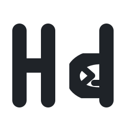

<div align="center">

<picture>
  <source media="(prefers-color-scheme: dark)" srcset="assets/helm-d-dark.svg">
  
</picture>

# helm-d

**A security-analysis plugin for DeepSeek Harness.**

37 tools · 362 on-demand references · enforced evidence chain · four hot-swappable persona profiles · local Team collaboration

[](https://github.com/ADWMC/helm-d/releases)
[](https://github.com/ADWMC/helm-d/stargazers)
[](https://github.com/ADWMC/helm-d/actions/workflows/ci.yml)
[](LICENSE)
[](https://hits.sh/github.com/ADWMC/helm-d/)
[](https://t.me/helm_xD)

[Install](#install) · [Quick start](#quick-start) · [Capabilities](#capabilities) · [Workbench](#workbench) · [Tools](#tools) · [Docs](#docs) · [中文](README.md)

</div>

> **For authorized security testing only.** Full legal terms in [DISCLAIMER.en.md](DISCLAIMER.en.md).

## Sponsors

> Want your project here? [Submit a sponsorship request](https://github.com/ADWMC/helm-d/issues/new?template=sponsor.yml).

<details open>
<summary>Expand / collapse sponsors</summary>
<br/>

<table>
<tr>
<td width="180" align="center" valign="middle"><a href="https://github.com/3641397194-wq/gpt6-Astra"></a></td>
<td><strong>Thanks to toki for sponsoring this project</strong> · <a href="https://github.com/3641397194-wq/gpt6-Astra">冷咖啡 · 破甲工作台</a> · <a href="https://coldcoffeeai.com/">Relay</a><br/>
One-click jailbreak and uninstall for eleven LLM clients, with Windows / macOS (arm64 · x64) / Linux installers. Tick the apps to patch, apply, then send the passphrase "冷咖啡" in the app; uninstall restores the original files.</td>
</tr>
<tr>
<td width="180" align="center" valign="middle"><a href="https://huablog.org"></a></td>
<td><strong>Thanks to Hua for sponsoring this project</strong> · <a href="https://huablog.org">Vector</a><br/>
One relay for 70+ models: Claude / Gemini / Codex / DeepSeek / Grok / Kimi / GLM. OpenAI from 0.065x, Plus 0.085x, Pro 0.165x, kiro 0.22x, ccmax 1.2x.</td>
</tr>
<tr>
<td width="180" align="center" valign="middle"><a href="https://tg.starontop.best/"></a></td>
<td><strong>Partner link</strong> · <a href="https://tg.starontop.best/">Quandianqian · Telegram account shop</a><br/>
Telegram / X / Apple / Google / GPT accounts and memberships, with order lookup and after-sales.</td>
</tr>
</table>

</details>

## What it is

helm-d is a [DeepSeek Harness](https://github.com/deepseek-ai/deepseek-harness) plugin. It does not modify the host binary; it adds four things through cordis hooks:

- **37 tools** across Android / Web / Native / Protocol / Malware / AI-Security, plus the case lifecycle, routing and local Team dispatch.
- **An evidence chain**: tool output lands in `evidence/`; conclusions must cite E ids and a reproducible `repro_cmd`.
- **On-demand knowledge**: 362 reference documents read through `read_reference`, never stuffed into the system prompt.
- **Four persona tiers**: ds4.1f / stealth / redteam-max / gpt-6x, switched from the workbench without restarting the host.

It is **not** an engine patch: no on-disk changes to approvals or the sandbox, and no separate process. It can coexist with patch-style tools.

## Install

**Requirements**: Node >= 22.19 and the [`dsh`](https://github.com/deepseek-ai/deepseek-harness) CLI.

```bash
dsh plugin --profile web add https://github.com/ADWMC/helm-d/releases/download/v0.5.3/helm-d.tgz
dsh web
```

> Use a versioned URL (`vX.Y.Z`). `releases/latest/download/*` is a rolling address; as a profile dependency it makes pnpm's lockfile sha512 fail after the next release (`ERR_PNPM_TARBALL_INTEGRITY`). See [install troubleshooting](docs/install-troubleshooting.md).

The boot-time health check validates and, when needed, repairs the preset against your installed dsh — no manual YAML editing.

> The web UI shows a Star prompt on first start. It **does not gate any feature** and can be skipped. Troubleshooting: [Star gate help](docs/star-gate-help.md).

## Quick start

1. Open a new DSH session and select the **helmd** agent preset.
2. Send `helmd` to activate it.
3. Do one read/list action first. The first turn only exposes `shell + read`; the full 37-tool catalog (including `begin_case`) appears on the next turn — that is the host promotion mechanism, not a broken plugin.
4. Give it a task, for example:

   > Analyze how `samples/app.apk` is protected, open a case, collect evidence, and finish with a conclusion that includes `repro_cmd`.

5. For a structured conclusion, let it run the case flow:

```text
begin_case(goal, samples)
  → tool output is written to evidence/ (E-001, E-002…)
  → record_finding(title, detail, evidence_ids, repro_cmd)
  → end_case(summary)
```

Citing an E id that does not exist is rejected. `repro_cmd` is required: a conclusion without a reproducible command is not a conclusion.

## Capabilities

| Capability | What you get |
|---|---|
| **Six domains** | Android unpacking/Frida, Web exploitation, Native packers and anti-reversing, Protocol capture, Malware IOC/YARA, AI-Security |
| **Case & evidence** | On-disk workspace, automatic evidence capture, E-id validation, `repro_cmd` gate; `case_status` restores context after compaction |
| **Persona profiles** | ds4.1f / stealth / redteam-max / gpt-6x; `POST /api/helmd/profile` disposes and re-registers the persona section in place — no host restart |
| **On-demand references** | 362 documents routed by `skill_catalog` and read by `read_reference`, not injected into the system prompt |
| **Autonomy packet** | `case_status` returns hypotheses, findings, evidence, dead ends, the matching playbook and the next action |
| **Workbench** | Six tabs — Armor / Case / Team / Intercept / Settings / About — with a sidebar-first entry, backed by `/api/helmd/*` |

<details>
<summary>What the four persona profiles change (expand)</summary>

| Profile | Positioning | Content |
|---|---|---|
| **ds4.1f** | "似乎是ds4.1f v10" — general-purpose default | Full base rules |
| **stealth** | "概率通用（轻量）" — low-noise | ds4.1f + minimal output / read-first / single-target focus |
| **redteam-max** | "概率通用（加厚）" — heavier pentest | ds4.1f + full attack chain / dual-column output / complete deliverables |
| **gpt-6x** | "gpt 6x" — standalone CTF-sandbox tier | Helm-X v6: CTF framing, scoring table, four-role delivery contract (not yet tested on DSH) |

All three are sealed in `profiles.dat`. Switching disposes the old section and re-registers it in place; no host restart.

</details>

## Workbench

Click the `helmd` workbench button in the DSH session header. It opens the right sidebar first and falls back to a popover only when the sidebar service is unavailable:

- **Profiles**: switch between the four personas live.
- **Case**: the case bound to this session — hypotheses, findings, evidence and open questions. When unbound it shows a hint plus recent on-disk cases instead of another session's investigation.
- **Team**: local multi-agent collaboration — tickets, role workers, reports, evidence, evolution revisions and the A/B gate.
- **Intercept**: counts and excerpts from the stream refusal loop.
- **Settings**: Team concurrency / default roles / auto-ticket, intercept switch, autonomy helpers, Star delay — one store shared with the DSH settings page.
- **About**: version, author, disclaimer, update address, changelog and an on-demand update check.

## Tools

Most-used entry points: `begin_case` / `case_status` / `record_finding` / `update_finding` / `end_case` / `route_task` / `read_reference` / `analysis_mode` / `team_create` / `team_dispatch` / `team_status`.

<details>
<summary><strong>All 37 tools (expand by domain)</strong></summary>

| Domain | Tools |
|---|---|
| **Case** | `begin_case` `case_status` `record_finding` `update_finding` `save_evidence` `end_case` |
| **Case / hypothesis** | `record_hypothesis` `update_hypothesis` |
| **Routing / knowledge** | `skill_catalog` `read_reference` `route_task` `analysis_mode` |
| **Android** | `apk_fingerprint` |
| **Web** | `web_reference` `bot_analyze` |
| **Native** | `native_reference` `detect_packer` `scan_strings` `xor_bruteforce` `encoding_detect` |
| **Protocol** | `protocol_reference` `pcap_parse` `state_machine` `parse_har` |
| **Malware** | `malware_reference` `ioc_extract` `yara_gen` |
| **AI-Security** | `ai_reference` `llm_sim` |
| **Evidence** | `evidence_reference` `triage_artifact` `hash_artifact` |
| **Toolbox** | `tool_recommend` |
| **Team** | `team_dispatch` `team_create` `team_status` `team_report` |

</details>

## References

The 362 documents live in [`references/`](packages/helmd/references/index.md): Android unpacking and Frida templates, Web exploitation playbooks, Native packer and anti-reversing notes, Protocol capture and state machines, Malware IOC/YARA, AI-Security prompt injection, and evidence/report templates. The model reads them on demand; they are ammunition, not hard rules.

## How it runs

```text
request → first-turn anchor (shell + read) → route_task
        → domain tools / read_reference → evidence/ (E ids)
        → conclusion with confidence and repro_cmd
```

<details>
<summary>Architecture and runtime hooks (expand)</summary>

- `bootstrap`: first turn exposes only the platform shell + `read`; promotes after a tool call or assistant message.
- `gate`: registers the `helm-d:persona` section; the Star panel is a notice layer only and never gates a feature.
- `persist`: captures output from every later-registered domain tool into `evidence/`.
- `advisory-hook` / `llm-stream-hook` / `ica-context`: refusal detection, stream interception loop and behavior examples.
- `router` + `case`: domain routing, case lifecycle and the `[autonomy]` state packet.

See [architecture](docs/architecture.md) and [design principles](docs/principles.md).

</details>

## Validation

- The eight original prompts passed the 60-second no-refusal protocol **8/8**; full data and grading are in the [evaluation report](docs/reports/FINAL-REPORT-v9.md).
- BoosterX v2.2.4.3 (.NET) license bypass: **32,316 method bodies** restored and **7,726 encrypted constants** decrypted under ConfuserEx; see the [case study](docs/case-studies/boosterx-dotnet-license-bypass.md).

## Community listings

| Directory | Notes |
|---|---|
| [dshfind](https://dshfind.com/en/plugins/ADWMC/helm-d) | Plugin marketplace with three embeddable badges (small / downloads / card) |
| [DeepSeek Harness Plugin](https://deepseek-harness-plugin.com/plugins/helm-d/) | Independent directory with install command and install-time risk note |
| [awesome-dsh-plugin](https://awesome-dsh-plugin.com/p/ADWMC/helm-d--packages-helmd/) | Categorised directory with community comments |

## Star history

<details>
<summary>Expand the star curve</summary>
<br/>

<a href="https://star-history.com/#ADWMC/helm-d&Date"></a>

</details>

## Compatibility, update and uninstall

| Item | Requirement |
|---|---|
| DSH | 0.2.x (this release tested on `0.2.1-rc.2`) |
| Node | `>= 22.19.0` |
| Platform | Windows uses `pwsh`; Linux / macOS use `bash`; WSL via `wsl.exe` |

```bash
# Update: remove first, then install the target version (never latest/download)
dsh plugin --profile web remove @adwmc/helm-d
dsh plugin --profile web add https://github.com/ADWMC/helm-d/releases/download/v0.5.3/helm-d.tgz

# Uninstall
dsh plugin --profile web remove @adwmc/helm-d
```

Replace `v0.5.3` with the target Release tag; do not use `releases/latest/download/*` as a profile dependency.

## Docs

- [Star gate help](docs/star-gate-help.md)
- [Install troubleshooting (ERR_PNPM_TARBALL_INTEGRITY)](docs/install-troubleshooting.md)
- [Design principles](docs/principles.md)
- [Architecture](docs/architecture.md)
- [Development and release](docs/development.md)
- [Security boundary and reporting](SECURITY.md)
- [Maintenance](MAINTENANCE.md)
- [Changelog](CHANGELOG.md)
- [Case study: BoosterX .NET license bypass](docs/case-studies/boosterx-dotnet-license-bypass.md)
- [Eight-task evaluation report](docs/reports/FINAL-REPORT-v9.md)
- [Master plan: professional RE + pentest chains](docs/design/MASTER-PLAN-PRO-RE-PENTEST.md)

## Community and support

- Questions and requests: [GitHub Issues](https://github.com/ADWMC/helm-d/issues)
- Star gate issues: [Star gate help](docs/star-gate-help.md)

If helm-d is useful to you, a Star is appreciated.

## Acknowledgements

helm-d combines design ideas and implementation patterns from these open-source projects:

- [ADWMC/helm-x](https://github.com/ADWMC/helm-x) — prompt injection and scoring design
- [yynxxxxx/Codex-X](https://github.com/yynxxxxx/Codex-X) — prompt templates and visual management
- [dsh-purge](https://github.com/YuJunZhiXue/dsh-purge) (YuJunZhiXue) — tool-description washing and input normalization reference
- [dsh-purge-community](https://github.com/kingcharleslzy-ai/dsh-purge) (Jueze-2019, MIT) — the `presets/boost.txt` tail override block

## Contributing

Issues and PRs are welcome. Read [CONTRIBUTING.md](CONTRIBUTING.md) and [docs/principles.md](docs/principles.md) first. Two architectural constraints stay fixed: **evidence must enter the chain, and references are read on demand**.

## License

[GNU Affero General Public License v3.0](LICENSE) (SPDX: `AGPL-3.0-or-later`), Copyright (C) 2026 ADWMC. You may use, modify and distribute the project under AGPL v3 or any later version published by the Free Software Foundation.

- **Network use (§13)**: if you run this plugin, or a modified version, as a network service, you must offer its users the Corresponding Source. That source is this repository: the sealed `profiles.dat` / `references.dat` / `payload.dat` in the npm package are regenerated from the plaintext sources here (`packages/helmd/scripts/build-profiles.mjs`, `build-sealed.mjs`), so the package carries no separate closed component.
- **Redistribution**: pass on the full license text, keep the copyright and third-party notices, and license the result under the AGPL as well.
- **Contributions**: submitting a PR means you license it under `AGPL-3.0-or-later` and confirm you have the right to do so.
- **Third-party components**: the `presets/boost.txt` tail block comes from [dsh-purge-community](https://github.com/kingcharleslzy-ai/dsh-purge) (MIT, © 2026 Jueze-2019) and stays MIT; the other credited projects inspired the design only, with no code copied. Third-party articles and snippets referenced under `references/` remain under their authors' licenses.

## Disclaimer and Terms of Use

> [!WARNING]
> Own assets only, or an assessment you are authorized in writing to perform. The software ships offensive-security techniques, automation and AI-assisted content; misuse is your responsibility.

| Permitted | Prohibited |
|---|---|
| Own/authorized assets · reverse engineering · forensics · CTF · detection research | Unauthorized intrusion · DoS · extortion · malware · privacy harm · licence circumvention |

- **No warranty**: provided "as is", without any express or implied warranty; see the full text for liability limits and indemnification.
- **Not official**: no affiliation with, sponsorship by or endorsement from DeepSeek, DeepSeek Harness or their maintainers.
- **Output risk**: results may be wrong or stale and are not professional advice; verify before acting.
- **Network behaviour**: only the update check and star verification contact GitHub / npm; the plugin uploads no samples or evidence.
- **Jurisdictions**: EU (GDPR / CRA / dual-use), China (Criminal Law 285/286, Cybersecurity Law, Cryptography Law) and US (CFAA / DMCA §1201 / EAR) summaries in §15.
- **Third party**: `boost.txt` comes from dsh-purge-community (MIT, Jueze-2019); material quoted under `references/` stays with its authors.

The full terms — definitions, your representations, prohibited uses, indemnification, export control, the three jurisdictions, governing law and 17 sections in total — are in **[DISCLAIMER.en.md](DISCLAIMER.en.md)**.
