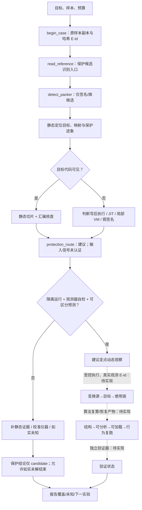

# 保护目标：当前执行流程与缺口

> 此图只表示仓库现已实现的动作；虚线含义为**尚未实现**。目标判定输入当前由模型填写，`protection_route` 只核对 Case 与 E-id 存在，不验证其语义；宿主 shell 仍是独立执行入口。

## 逐段完成判据

| 段 | 当前结果 | 完成还需要什么 |
|---|---|---|
| 知识入口 | 已重写保护识别、加壳处理、决策树和触发表；删除“签名即确认、OEP 立即 dump、静态最后手段”等绝对规则。 | 按 [reverse-skill-audit-protocol.md](reverse-skill-audit-protocol.md) 对长尾参考及外部技能做逐条对照与固定任务集测试。 |
| 候选分流 | `protection_route` 纯函数有假签名、观测器故障、局部 VM、无隔离环境测试；模型工具须有现存 E-id。 | 输入观测仍是模型自述，不是从工具原始记录计算，不能认为对模型乱做有强阻断。 |
| 结论晋升 | Case 核心拒绝保护结论从 candidate 晋升 verified；工具与工作台 API 一并覆盖。Deep Case 可用明确未定理由结束，调度提示不强迫 blocked 假设生成 finding。 | 当前防护依赖保护术语，换词可绕过；需按结构化结论类型及真实验证事件签发证明，而非关键词。 |
| 动态/解密 | 文档写明条件、分层对象及产物等级；没有默认自动运行。 | 受控执行器、宿主 shell 旁路审计、真实 trace/dump 绑定、具体算法识别及跨环境复跑；缺样本和可控目标环境时无法进行端到端评估。 |
| 论文评测 | 保守路由和接口的合成反例检查通过。 | 冻结基准/技能快照、真实保留样本、配对旧/新调度、故障注入、重复试验与统计区间；没有数据就不报告提升。 |

不可把“已有文档”或“37 项仓库检查通过”解释为完整系统已经实现。宿主入口未审计前，本版本仅声称**有条件建议、局部写入护栏及如实关案**，不声称所有模型动作受控。
